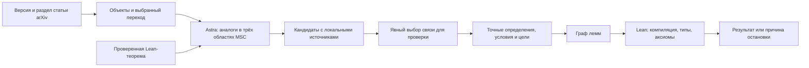
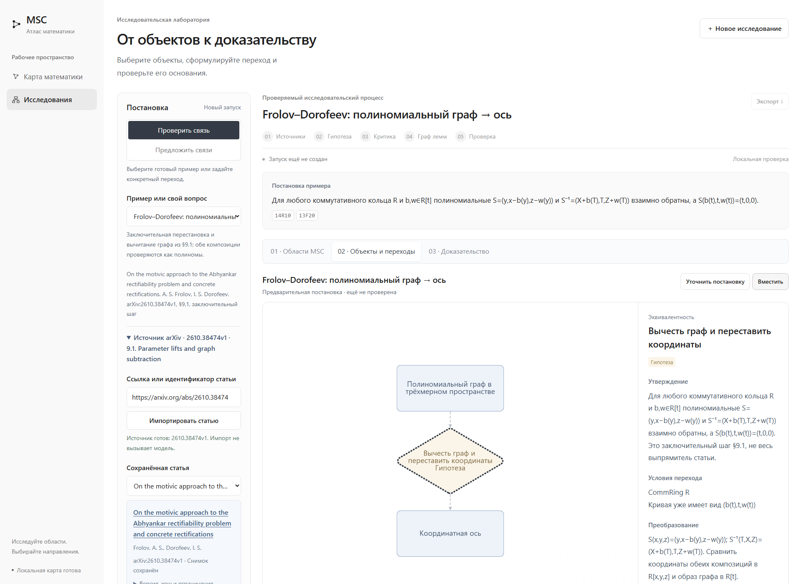

# SHAIM · исследовательская лаборатория математики

Локальная лаборатория для исследования математических связей. Основной путь
версии **0.3.0**: импортировать статью, выбрать её конкретный переход, найти
возможные аналоги в трёх других областях MSC2020 и отдельно проверить выбранную
общую структуру в Lean. Найденная аналогия — кандидат, а не готовое доказательство.
Также можно начать с одной проверенной Lean-теоремы или готового источника.



| Компонент | Что делает |
|---|---|
| Интерфейс и карта MSC2020 | Позволяют выбирать источник, переход и этап просмотра; навигация не запускает модель. |
| Граф объектов / граф лемм | Сохраняют конструкции и их условия / план и фактические зависимости доказательства. Это разные графы. |
| LangGraph и SQLite | Управляют стадиями выполнения и checkpoints. Это механизм оркестрации, а не доказатель. |
| Наш код по мотивам Goedel-Architect | Реализует роли планировщика, критика и исполнителей, граф обязательств и ограниченное исправление. Готовый движок Goedel-Architect не подключён. |
| Astra через Codex App Server | Предлагает направления, формулировки и доказательства; ответы могут оказаться неполными или ошибочными. |
| Lean и аудит | Проверяют точную формальную цель, обязательства и аксиомы. Отдельная модельная рецензия оценивает соответствие замыслу и не заменяет Lean. |

## Что уже работает

- Полная карта MSC2020: поиск, навигация по рубрикам и официальным отсылкам.
- Граф объектов и переходов: определения, предпосылки, источники, редактор постановки,
  неизменяемые версии и история результатов.
- Явный импорт ссылки или ID arXiv: конкретная версия, исходный HTML, разделы,
  формулы MathML/LaTeX и хеши источников. Литературная карточка сохраняется отдельно
  от её последующей формализации.
- Поиск по локальному корпусу и текстовому индексу mathlib; дополнительный поиск
  по типу леммы и диагностике после неудачной Lean-проверки.
- Карточки кандидатов с причинами остановки и последовательная очередь проверки:
  состав и общий лимит подтверждаются до запуска; результаты каждой связи сохраняются.
- Один исследователь или команда ролей: план, критика, ограниченные исправления,
  до двух независимых доказательств одновременно и итоговая композиция.
- Проверка всех обязательных целей выбранного перехода, аудит аксиом, отдельная
  проверка соответствия математическому замыслу, сохранение частичных попыток.

Поиск ограничен установленным индексом деклараций mathlib/Lean и подготовленным
локальным корпусом. Сеть используется для импорта явно указанной статьи;
глобальный поиск по arXiv и автоматический обход литературы не подключены.
Текстовая найденная сигнатура ещё не подтверждает применимость теоремы.
Импорт не доказывает всю статью, а отсутствие кандидатов не доказывает отсутствия связи.

## Два готовых источника

В публичном каталоге лаборатории ровно два воспроизводимых примера. Их готовые
Lean-исходники служат отправной точкой поиска; новое исследование от них имеет
собственный бюджет и не наследует успех исходной теоремы.



| Пример | Источник и точная область проверки |
|---|---|
| **Полиномиальный граф → координатная ось** | A. S. Frolov, I. S. Dorofeev, *On the motivic approach to the Abhyankar rectifiability problem and concrete rectifications*, [arXiv:2610.38474v1](https://arxiv.org/abs/2610.38474v1). Заключительный шаг §9.1: две композиции взаимно обратных полиномиальных преобразований и образ уже заданного графа. [Исходник, объекты и ограничения](apps/msc-lean-atlas/examples/arxiv_graph_subtraction/README.md). |
| **Ассоциатор ↔ энергия графового лапласиана** | Наш ранее опубликованный препринт [«Связи математических объектов и общие структуры: три пары с проверкой в Lean»](docs/Preprint.pdf), версия 1.5. Точное равенство двух энергий в рациональной координатной модели с тремя вершинами и весами `(dᵢ−dⱼ)²/4`; используется опубликованная теорема `associatorDirichlet_graphLaplacian`. [Два объекта и мост](apps/msc-lean-atlas/examples/astra_energy/). |

В выборе **«Готовый пример»** подготовлены теоремы
`Arxiv261038474.subtract_restore` и `Bridge.energy_correspondence`.
Первое добавление готового источника выполняет локальную инспекцию Lean без Astra;
для ассоциатора собираются необходимые зависимости `MathResearch`. Интерфейс
может повторно открыть уже сохранённый проверенный источник.
Это повторное использование известных исходников, не слепое переоткрытие.

Первый пример не проверяет предшествующее приведение произвольной кривой к графу,
выпрямители узлов или мотивную часть статьи. Второй воспроизводит конкретную
опубликованную связь; он не является новой теоремой об эквивалентности произвольных
алгебр и графов. Внутренние отрицательные контроли и исторические задачи остаются
в тестах и архивных материалах, а не в основном выборе примеров.

## Окружение

| Компонент | Версия и способ фиксации |
|---|---|
| Lean | **4.19.0**, файл `lean-toolchain` |
| mathlib | Коммит **`c44e0c8ee63ca166450922a373c7409c5d26b00b`**, `lakefile.toml` и `lake-manifest.json` |
| Python | Для приложения используйте **3.12**; локально проверена **3.12.10**. Пакеты закреплены в `requirements-research.lock` |
| LangGraph | **1.2.18**, SQLite checkpoint backend **3.1.2** в Python lockfile |
| JavaScript | Готовая сборка включена. `cytoscape` **3.34.4**, `cytoscape-dagre` **4.0.1**, `cytoscape-fcose` **2.2.0** закреплены в `package-lock.json` |
| Node.js | Нужен для JS-тестов и пересборки frontend; проверена **24.15.0** |
| Codex | Проверен CLI **0.165.0-alpha.1.2**, транспорт `app-server --listen stdio://`, точная модель **`gpt-6-astra`** |

Версии Python, Node и Codex в таблице описывают ранее проверенную среду; репозиторий
не устанавливает и не закрепляет их исполняемые файлы. Lean, mathlib и зависимости
приложения закреплены файлами проекта. Для Codex необходимы доступный CLI,
авторизация в установленном Codex и доступ к указанной модели. Приложение использует
эту авторизацию и не просит API-ключ в интерфейсе. Подмена модели не выполняется.

## Запуск на Windows

Предварительно установите Git, Python 3.12 и [Lean/Lake через elan](https://lean-lang.org/install/manual/).
Команды выполняются в PowerShell:

```powershell
git clone https://github.com/Medrov/astra-math-research.git
cd astra-math-research
lake update
lake exe cache get

cd apps/msc-lean-atlas
python -m venv .venv
.\.venv\Scripts\python.exe -m pip install -r requirements-research.lock
.\start.ps1 -Port 8765
```

Откройте **<http://127.0.0.1:8765/#research>**; карта находится по
<http://127.0.0.1:8765/#map>. `start.ps1` включает UTF-8 и выбирает закреплённый
компилятор через `elan which lean`. Сервер останавливается `Ctrl+C`.
Если политика PowerShell запрещает скрипт, разрешите выполнение только для
этого процесса:

```powershell
powershell -NoProfile -ExecutionPolicy Bypass -File .\start.ps1 -Port 8765
```

## Запуск на Linux / macOS

Нужны Git, Python 3.12 с модулем `venv` и [elan](https://lean-lang.org/install/manual/):

```sh
git clone https://github.com/Medrov/astra-math-research.git
cd astra-math-research
lake update
lake exe cache get

cd apps/msc-lean-atlas
python3.12 -m venv .venv
.venv/bin/python -m pip install -r requirements-research.lock
export PYTHONUTF8=1
export ATLAS_LEAN="$(elan which lean)"
./start.sh --port 8765
```

Карта и просмотр сохранённых данных работают без вызовов модели. Для агентного
запуска CLI `codex` должен находиться в `PATH`; при другой установке задайте
`SHAIM_CODEX_BIN` — полный путь к его исполняемому файлу. `GET /api/research/status`
проверяет доступность движка, авторизации и модели без генерации. Подробные
настройки путей и команды индексации — в [README приложения](apps/msc-lean-atlas/README.md).
Для примера ассоциатора нужные модули `MathResearch` компилируются заново в рабочем
каталоге конкретного запуска. Предварительная сборка всего исторического комплекта
для старта лаборатории не требуется.

## Как работать

1. Откройте `#research`, загрузите явную arXiv-ссылку и выберите раздел. Импорт
   сохраняет версию и хеш текста, не вызывает Astra. Отдельная кнопка запускает
   извлечение объектов и переходов из доступных фрагментов статьи.
2. Выберите переход на карте. Сверьте всю связку **входные объекты → переход →
   выходные объекты**, его утверждение и условия. Выбор узла ничего не запускает.
3. Нажмите **«Найти аналоги в других областях»**. Модель предлагает общий механизм
   и три направления MSC; поиск сохраняет реальные результаты локального индекса.
   Предварительно доказывать исходное утверждение статьи для поиска не требуется.
4. Сравните **«Кандидаты и проверки»**. Проверьте одну доступную связь либо
   раскройте **«Проверить все доступные связи»**, прочитайте список и общий лимит
   и подтвердите последовательную очередь. Постановки, требующие уточнения,
   и уже проверенные цели пропускаются с объяснением.
5. В отдельном запуске формализатор готовит точную цель. Preflight проверяет
   определения и типы целей, но не доказывает их. Затем выполняются проверка
   замысла, граф лемм, доказательство, итоговая Lean-сборка и отдельная рецензия.
6. Прочитайте результат или причину остановки. Если нужно уточнение объёма,
   редактор создаёт новую версию перехода и его объектов. Её проверка запускается
   отдельно; старый сертификат не переносится автоматически.

Верхние кнопки **Источник → Направления и связи → Проверка Lean → Результат**
переключают просмотр того же исследования, сохраняя его источник, карту и версию.
Это навигация по данным, а не запуск следующей стадии LangGraph. История открывает
прежние попытки без повторного вызова модели. Номера на карте расшифрованы в списке;
цвет объекта обозначает область MSC, а не доказанность.

Основной UI задаёт **16 вызовов / 30 минут на этап или проверяемую связь**.
Извлечение, поиск аналогов и проверка имеют отдельные бюджеты; общий предел очереди
равен сумме бюджетов доступных связей и показан до подтверждения. У отдельных
вызовов сервиса есть собственные таймауты, поэтому запуск может прерваться раньше
общего лимита. После перезапуска сервера работа не продолжается автоматически.
Повторная проверка — явная новая попытка с прежним точным контрактом; результаты
и диагностика предыдущей сохраняются. Неизвестный исход отправки не повторяется скрытно.

Формальный успех означает доказательство выбранных целей при записанных условиях.
Он не доказывает применимость дополнительных условий моста к статье, содержательность
аналогии или научную новизну. План, некорректная постановка, неполученное доказательство,
отказ Lean и таймаут — разные исходы, ни один не означает «связь не существует».

Показательный предел: локальный поиск аналогов для *When Momentum Helps
Polyak–Ruppert Averaging* (arXiv:2610.27990v2) прервался по таймауту Codex
при подготовке кандидатов. Сохранено **0 кандидатов**, Lean не запускался.
Это диагностический эксперимент, а не третий готовый или доказанный пример.

## Проверка и документация

Из папки приложения, после подготовки Lean/mathlib:

```powershell
$env:PYTHONUTF8 = '1'
$env:ATLAS_LEAN = (& elan which lean).Trim()
.\.venv\Scripts\python.exe -m unittest discover -s tests -v
npm.cmd run test:graph
npm.cmd run test:objects
npm.cmd run test:structure
npm.cmd run test:guided
npm.cmd run test:research-map
npm.cmd run test:candidates
```

На Linux/macOS используйте `.venv/bin/python` и `npm`. Эти тесты не требуют
настоящих вызовов модели; интеграционные тесты используют явно обозначенные
подставные ответы, а Lean-тестам нужны реальные подготовленные зависимости.
Пропуски Lean-тестов следует отличать от успешного выполнения.

- [Установка, интерфейс и команды приложения](apps/msc-lean-atlas/README.md).
- [Архитектура, схемы, версии и HTTP API](apps/msc-lean-atlas/OBJECT_GRAPH.md).
- [Метод, источники и границы математических выводов](apps/msc-lean-atlas/RESEARCH_METHOD.md).
- [Поиск общей структуры: основной путь и ограничения](apps/msc-lean-atlas/COMMON_STRUCTURE.md).
- [Состав публикации и проверочные отчёты](apps/msc-lean-atlas/PUBLICATION.md).
- [Контракт Codex App Server](apps/msc-lean-atlas/CODEX_ADAPTER.md).

Изменения выпуска: [RELEASE_NOTES.md](apps/msc-lean-atlas/RELEASE_NOTES.md).
Отчёт координатора для 0.3.0: [release-0.3.0.json](apps/msc-lean-atlas/checks/release-0.3.0.json).
Дату, ревизию и область проверки нужно читать в самом отчёте; обновление README
не означает новый успешный прогон. В чистом клоне некоторые тесты исторических
локальных запусков явно пропускаются: их данные не входят в Git.
Предыдущая сводка: [release-summary.json](apps/msc-lean-atlas/checks/release-summary.json).
Отдельный разбор статьи и границы проверки:
[arxiv-study.json](apps/msc-lean-atlas/checks/arxiv-study.json).

Старый математический комплект сохранён отдельно: `MathResearch.lean` и
`MathResearch/` содержат 11 исходников и 149 деклараций. Его полная проверка —
`python3 scripts/check.py` по [REPRODUCE.md](REPRODUCE.md). Эти числа не включают
примеры лаборатории. Исторические три ветви, агентные задания и материалы:
[WALKTHROUGH.md](WALKTHROUGH.md), [препринт](docs/Preprint.pdf),
[интерактивный атлас](docs/Interactive.html), [описание пайплайна](docs/Pipeline.html).

`research_data/`, виртуальные окружения, сессии Codex и рабочие журналы в Git
не входят. Отчёты в `checks/` относятся к указанным в них версиям и датам;
локальная новая проверка должна иметь свой код завершения и новый отчёт.
[GitHub Pages](https://medrov.github.io/astra-math-research/) показывает статические
материалы; для исследований, Codex и Lean нужен локальный Python-сервер.
