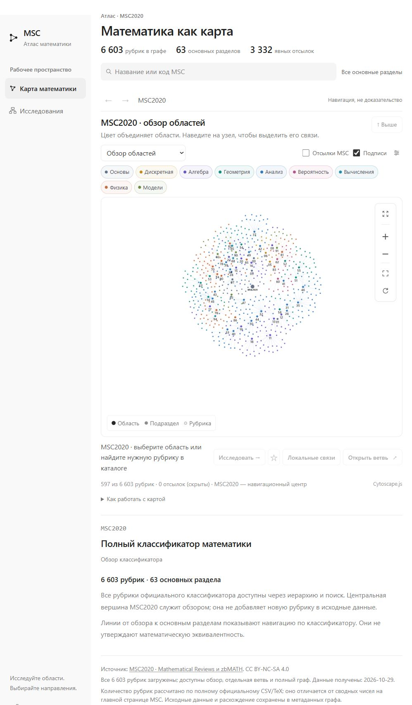
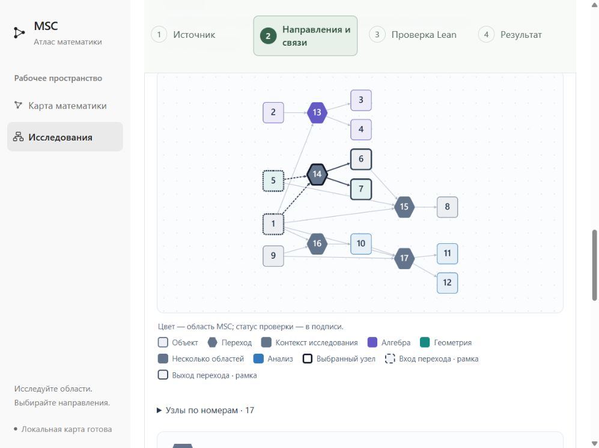
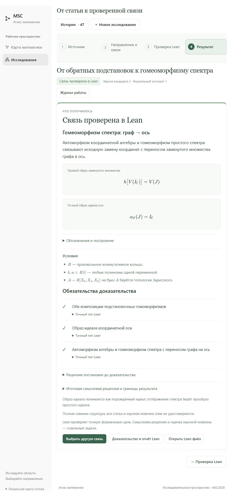
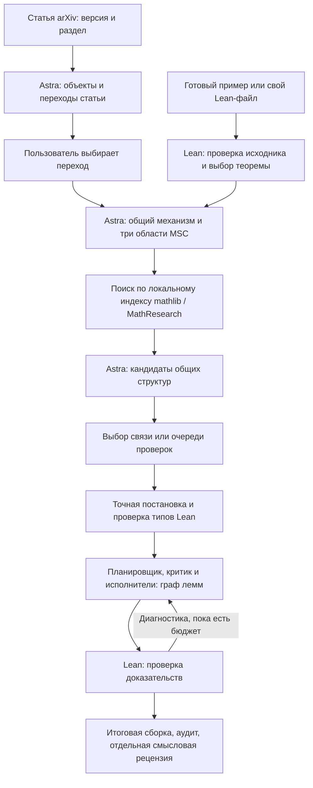

# Математический атлас

Локальное приложение для поиска общей структуры в разных областях математики.
Вы выбираете переход из статьи или Lean-теорему; Astra предлагает аналоги
в трёх областях MSC2020, а Lean проверяет выбранную формальную связь.
Весь путь запускается из интерфейса, без команд в чате.

**Текущая версия — [v0.3.0](https://github.com/Medrov/astra-math-research/releases/tag/v0.3.0).**
В ней есть карта математики, импорт arXiv, два готовых источника, поиск аналогов,
графы объектов и лемм, отдельная проверка Lean, история и очередь проверок.

[Запуск](#быстрый-запуск) · [Первое исследование](#первое-исследование) ·
[Интерфейс](#как-устроен-интерфейс) · [Скриншоты](#как-выглядит-атлас) ·
[Архитектура](#что-работает-внутри) ·
[Проверки](#проверки-и-повторение-результатов)

## Быстрый запуск

Для полного сценария нужны **Git, Python 3.12, Lean/Lake через
[elan](https://lean-lang.org/install/manual/)** и доступный **Codex CLI**
с существующей авторизацией и моделью **`gpt-6-astra`**.
Просмотр карты и локальная проверка готового Lean-источника модель не вызывают.
Node.js нужен только для frontend-разработки и тестов: браузерные ресурсы
уже включены в репозиторий.

### Windows · PowerShell

Один раз подготовьте проект:

```powershell
git clone https://github.com/Medrov/astra-math-research.git
cd astra-math-research
lake update
lake exe cache get

cd apps/msc-lean-atlas
python -m venv .venv
.\.venv\Scripts\python.exe -m pip install -r requirements-research.lock

# Построить локальный индекс для поиска похожих переходов.
.\.venv\Scripts\python.exe -X utf8 -c "import research_retrieval; print(research_retrieval.build_index())"
```

У результата индекса должны быть `status: ready`, источник `Mathlib`
в `sources` и ненулевые `files` / `declarations`. Индекс хранится локально;
запуск сервера не строит его автоматически. Без него поиск по трём областям
не получит библиотечных кандидатов.

Запустите приложение из `apps/msc-lean-atlas`:

```powershell
.\start.ps1 -Port 8765
```

Откройте **<http://127.0.0.1:8765/#research>**. Остановка — `Ctrl+C`.
При следующих запусках достаточно этой команды, если окружение уже подготовлено.
Скрипт включает UTF-8 и выбирает Lean через `elan which lean`.
Если PowerShell блокирует `.ps1`, используйте запуск с политикой только для
этого процесса:

```powershell
powershell -NoProfile -ExecutionPolicy Bypass -File .\start.ps1 -Port 8765
```

### Linux / macOS

После установки Git, Python 3.12 с `venv` и elan:

```sh
git clone https://github.com/Medrov/astra-math-research.git
cd astra-math-research
lake update
lake exe cache get

cd apps/msc-lean-atlas
python3.12 -m venv .venv
.venv/bin/python -m pip install -r requirements-research.lock
export PYTHONUTF8=1
export ATLAS_LEAN="$(elan which lean)"
.venv/bin/python -c 'import research_retrieval; print(research_retrieval.build_index())'
./start.sh --port 8765
```

Откройте тот же адрес `http://127.0.0.1:8765/#research`.

Для генерации `codex` должен быть доступен в `PATH`; настройка другого пути
описана в [контракте адаптера](apps/msc-lean-atlas/CODEX_ADAPTER.md).
На Windows одного установленного Desktop-приложения без
доступного исполняемого файла CLI недостаточно. Доступность подключения,
авторизации и модели показывает <http://127.0.0.1:8765/api/research/status>;
эта проверка не запускает генерацию. Модель автоматически не подменяется.
Подробности — в [контракте адаптера](apps/msc-lean-atlas/CODEX_ADAPTER.md).

## Первое исследование

### Начать с готовой теоремы

1. Откройте **«Исследования» → «Готовый пример»**.
2. Выберите **«Фролов–Дорофеев · проверенный полиномиальный шаг §9.1»**
   и нажмите **«Открыть пример»**. При первом добавлении источник проверяется
   в Lean; повторное открытие может использовать уже сохранённый проверенный вход.
3. Оставьте рекомендованную теорему `Arxiv261038474.subtract_restore`.
   Прочитайте формулы, условия и **«Точную формулировку Lean»**.
4. При необходимости раскройте **«Пожелания и лимит работы»**, затем нажмите
   **«Найти связи в трёх областях»**. Здесь начинается работа Astra.
5. После поиска изучите три направления MSC, причины их выбора, библиотечные
   источники и найденные кандидаты. Выберите **«Проверить связь»** в карточке
   или **«Проверить общую структуру в Lean»** на карте.
6. Дождитесь отдельного запуска проверки. В результате прочитайте точную цель,
   условия, граф лемм, отчёт Lean и смысловую рецензию либо причину остановки.

Области подбирает модель. Пользователь выбирает найденную связь для проверки.
Чтобы проверить несколько, нажмите **«Проверить все доступные связи»**,
просмотрите состав и общий лимит, затем **«Начать проверку · N»**.
Очередь выполняется последовательно и сохраняет результат каждой попытки.

### Начать со своей статьи или файла

Для статьи: **«Статья arXiv» → «Загрузить источник» → выбрать раздел →
«Найти переходы в статье»**. Импорт сохраняет версию и текст; последующая
команда вызывает Astra для извлечения объектов и переходов.
Выберите переход на карте, проверьте связку **входные объекты → переход →
выходные объекты** и нажмите **«Найти аналоги в других областях»**.
Далее действуйте как в шагах 5–6 выше. Предварительное доказательство всей
статьи для поиска не требуется.

Для Lean: **«Мой Lean-файл» → выбрать один `.lean` → «Проверить источник»**.
После проверки компиляции и аксиом выберите теорему и нажмите
**«Найти связи в трёх областях»**. Поддерживаемые импорты обычной загрузки —
Mathlib/Init/Std; готовый опубликованный пример отдельно использует закреплённые
модули проекта.

## Как устроен интерфейс

В боковой панели два раздела: **«Карта математики»** для просмотра MSC2020
и **«Исследования»** для работы с источником и доказательством.
В исследовании четыре верхних этапа:

| Этап | Что здесь смотреть |
| --- | --- |
| **Источник** | Версию статьи, выбранный раздел или исходную Lean-теорему. |
| **Направления и связи** | Предложенные области MSC, основания поиска, карту объектов, кандидатов и состояния их проверок. |
| **Проверка Lean** | Точную постановку, проверку типов, граф обязательств и диагностику доказательства. |
| **Результат** | Что проверено при каких условиях, смысловую рецензию и границы результата либо причину остановки. |

Верхние этапы — кнопки просмотра: можно вернуться назад без повторного вызова
модели. **«История»** открывает прежние исследования; **«Журнал работы»**
показывает ход выбранной попытки. Новое исследование начинается отдельной кнопкой.

На карте объекты и переходы обозначены номерами; список расшифровывает название,
тип и MSC каждого узла. Выбор перехода выделяет его входы, выходы и стрелки.
Цвет относится к области математики, статус проверки показан отдельно.
Формулы отображаются через KaTeX, точные типы Lean можно раскрыть.

## Как выглядит атлас

Снимки текущего интерфейса сделаны 1 ноября 2026 года. Источник и результаты
открыты из локальной базы; новые вызовы Astra ради снимков не запускались.
В чистом клоне история пуста — показанные сессии в него не переносятся.

**Карта математики.** Обзор MSC2020, поиск по коду или названию и переход
в конкретную область. Цвета обозначают тематические группы.



**Объекты и переходы.** Сохранённый поиск по примеру Фролова–Дорофеева:
квадраты — объекты, шестиугольники — переходы. Выбран переход №14
к гомеоморфизму спектра; выделены его входы №1 и №5 и выходы №6 и №7.
Расшифровки номеров и рубрики MSC открываются в интерфейсе.



**Результат Lean.** Для этого перехода показаны формулы переноса идеала
и замкнутого множества, условия и три проверенных обязательства.
Это сохранённое доказательство конкретного моста, не формализация всей статьи.



Ещё два экрана — [выбор исходной теоремы и граф лемм](apps/msc-lean-atlas/README.md#скриншоты-исследования).

## Что работает внутри



| Инструмент | Роль в системе |
| --- | --- |
| **MSC2020** | Классификатор областей и направлений поиска. Сам по себе не устанавливает математическую связь. |
| **Astra (`gpt-6-astra`)** | Извлекает конструкции, предлагает направления и мосты, формализует цели, пишет и исправляет доказательства. |
| **Codex App Server** | Связывает Python-контроллер с Astra по `stdio`; использует существующую авторизацию Codex. |
| **LangGraph + SQLite** | Управляют этапами, состоянием, контрольными точками и продолжением работы. Графы на экране рисует другой компонент. |
| **Контроллер доказательства** | Собственная реализация планировщика, критика, исполнителей лемм и ограниченного исправления доказательства в LangGraph. |
| **Lean 4 + mathlib** | Проверяют формальные типы, доказательства, все обязательные цели и зависимости от аксиом. Lean работает локально. |
| **SQLite FTS5** | Ищет по явно построенному индексу заголовков деклараций и документации mathlib/MathResearch. Найденные тексты ещё требуют проверки применимости. |
| **Cytoscape.js, fCoSE, Dagre; KaTeX** | Отрисовывают карты и граф лемм; показывают математические формулы. |
| **Локальный Python HTTP-сервер** | Обслуживает интерфейс и API, хранит статьи, версии графов, попытки и отчёты на компьютере пользователя. |

**Статус Goedel-Architect: не интегрирован.** От него заимствована идея
планирования через граф лемм, но [оригинальный проект](https://github.com/goedelarchitect/goedel-architect)
не установлен и не вызывается нашим pipeline. Наличие похожих ролей
не означает использование его движка. Подключение оригинала остаётся
отдельной незавершённой задачей.

В основном интерфейсе используется **«Агентное исследование»** с командой ролей.
Отдельные независимые леммы могут доказываться параллельно — максимум две.
Найденная связь попадает в тот же процесс формализации и доказательства;
поиск сам по себе не выдаёт сертификат.

Три представления выполняют разные задачи: **карта MSC** показывает области,
**граф объектов и переходов** — исследуемые конструкции, **граф лемм** —
план доказательства и после успешной сборки его фактические зависимости.

## Два готовых примера и точные результаты

| Пример | Что уже проверено |
| --- | --- |
| **Фролов–Дорофеев** | A. S. Frolov, I. S. Dorofeev, *On the motivic approach to the Abhyankar rectifiability problem and concrete rectifications*, [arXiv:2610.38474v1](https://arxiv.org/abs/2610.38474v1), §9.1. Полиномиальные преобразования вычитания и восстановления графа взаимно обратны; заданный граф переходит в координатную ось. Вход: `Arxiv261038474.subtract_restore`. [Исходник и границы](apps/msc-lean-atlas/examples/arxiv_graph_subtraction/README.md). |
| **Ассоциатор ↔ энергия графового лапласиана** | Наш [препринт «Связи математических объектов и общие структуры: три пары с проверкой в Lean»](docs/Preprint.pdf), v1.5. Равенство двух энергий в рациональной координатной модели с тремя вершинами и весами `(dᵢ−dⱼ)²/4`. Вход: `Bridge.energy_correspondence`, использующий опубликованную теорему `associatorDirichlet_graphLaplacian`. [Объекты и мост](apps/msc-lean-atlas/examples/astra_energy/). |

Для первого примера сохранены результаты реального поиска Astra: мост к
автоморфизму координатной алгебры и мост к гомеоморфизму её спектра.
[Код, точные цели и повторение без модели](apps/msc-lean-atlas/examples/common_structure/README.md).
Готовые исходные доказательства доступны новому поиску: это повторное
использование известных результатов, а не слепое переоткрытие.

## Как читать результат

**Проверка постановки** подтверждает определения и тип цели, но ещё не доказывает
утверждение. **Успех Lean** относится к точным формальным целям при записанных
условиях. **Смысловая рецензия Astra** отдельно оценивает соответствие исходному
замыслу; она не заменяет формальную проверку.

Если запуск остановился, результат указывает стадию и причину: нужно уточнить
постановку, Lean отверг её типы, доказательство не получено, проверка не прошла
или исчерпан лимит. Эти исходы не означают, что математическая связь невозможна.
**«Уточнить постановку»** сохраняет новую версию; **«Повторить проверку»** создаёт
новую попытку. Сохранённые результаты и ошибки предыдущей попытки остаются.

По умолчанию лимит — **16 вызовов Astra / 30 минут на этап или одну проверяемую
связь**. Импорт, извлечение переходов, поиск аналогов и доказательство — разные
действия; извлечение, поиск и доказательство имеют отдельные модельные бюджеты.
Общий предел очереди показан перед её запуском. После перезапуска сервера
незавершённая работа автоматически не продолжается.

Текущая система импортирует конкретную статью по ссылке и ищет по локальному
индексу; обход всего arXiv не подключён. Результаты не удостоверяют новизну,
всю исходную статью или применимость дополнительных условий моста к её объектам.
В частности, проверен заключительный шаг §9.1, а для спектра — гомеоморфизм
с топологией Зарисского и перенос идеала/множества нулей, без структурного пучка схемы.

## Если что-то не запускается

| Ситуация | Что проверить |
| --- | --- |
| Карта открывается, Astra недоступна | Codex CLI, его авторизацию, доступ к `gpt-6-astra` и `/api/research/status`. Настройка другого пути CLI — в [контракте адаптера](apps/msc-lean-atlas/CODEX_ADAPTER.md). |
| Три направления есть, библиотечная выдача пустая | Построен ли индекс и есть ли в нём `Mathlib`. Повторите команду `build_index()` из быстрого запуска после установки или изменения библиотеки. Пустая выдача сама по себе не опровергает связь. |
| Ошибка импорта arXiv | Ссылку, версию и доступность HTML статьи. PDF/OCR сейчас не заменяет отсутствующий HTML. |
| Lean не может собрать источник | Установлены ли закреплённый toolchain и mathlib, выполнен ли `lake exe cache get`. Пути можно задать через `ATLAS_LEAN`, `ATLAS_MATHLIB`, `ATLAS_PROJECT_ROOT`. |
| Порт занят | Запустите с другим портом, например `-Port 8777` на Windows, и откройте соответствующий URL. |

## Проверки и повторение результатов

Релиз v0.3.0 проверен на Windows с Python **3.12.10**, Node **24.15.0**,
Lean **4.19.0** и mathlib **`c44e0c8ee63ca166450922a373c7409c5d26b00b`**.
Версии Lean и mathlib закреплены в корне проекта. Python-зависимости, включая
LangGraph **1.2.18**, — в `requirements-research.lock`; JS-зависимости —
в `package-lock.json` приложения.

В [отчёте релиза](apps/msc-lean-atlas/checks/release-0.3.0.json): **283 Python-теста,
197 записей JavaScript TAP**, свежая проверка трёх мостов и исходного комплекта
**11 файлов / 149 деклараций**. Это результаты выпуска, не новый запуск при
редактировании этой инструкции. Некоторые тесты исторических локальных данных
в чистом клоне явно пропускаются.

Для повторения из папки приложения, с установленным Node.js:

```powershell
$env:PYTHONUTF8 = '1'
$env:ATLAS_LEAN = (& elan which lean).Trim()
npm.cmd ci --ignore-scripts
.\.venv\Scripts\python.exe -m unittest discover -s tests -v
node --test tests/test*.cjs
.\.venv\Scripts\python.exe tools/reproduce_common_structure.py
.\.venv\Scripts\python.exe tools/reproduce_common_structure.py --spectrum
```

На Linux/macOS используйте `.venv/bin/python` и `npm`. Эти команды не вызывают
модель; Lean-тестам нужны реальные подготовленные зависимости.
Исходный комплект `MathResearch.lean` и `MathResearch/` проверяется отдельно
командой `python3 scripts/check.py` по [REPRODUCE.md](REPRODUCE.md).

## Документация и данные

- [Подробности приложения, карты и технические команды](apps/msc-lean-atlas/README.md).
- [Поиск общей структуры](apps/msc-lean-atlas/COMMON_STRUCTURE.md).
- [Графы, версии, сертификаты и API](apps/msc-lean-atlas/OBJECT_GRAPH.md).
- [Метод и границы математических выводов](apps/msc-lean-atlas/RESEARCH_METHOD.md).
- [Состав публикации](apps/msc-lean-atlas/PUBLICATION.md) и [описание релиза](apps/msc-lean-atlas/RELEASE_NOTES.md).
- [Исторические три задачи](WALKTHROUGH.md), [препринт](docs/Preprint.pdf), [интерактивные материалы](docs/Interactive.html).
- [Источники MSC2020, атрибуция и лицензия](apps/msc-lean-atlas/data/ATTRIBUTION.md).

История, индекс библиотеки, статьи, версии графов и артефакты запусков находятся
в локальной `apps/msc-lean-atlas/research_data/` и не входят в Git. Новый клон
получает код и подготовленные примеры, но не чужие сессии и результаты.
[GitHub Pages](https://medrov.github.io/astra-math-research/) содержит статические
материалы; исследования выполняет локальный Python-сервер.
