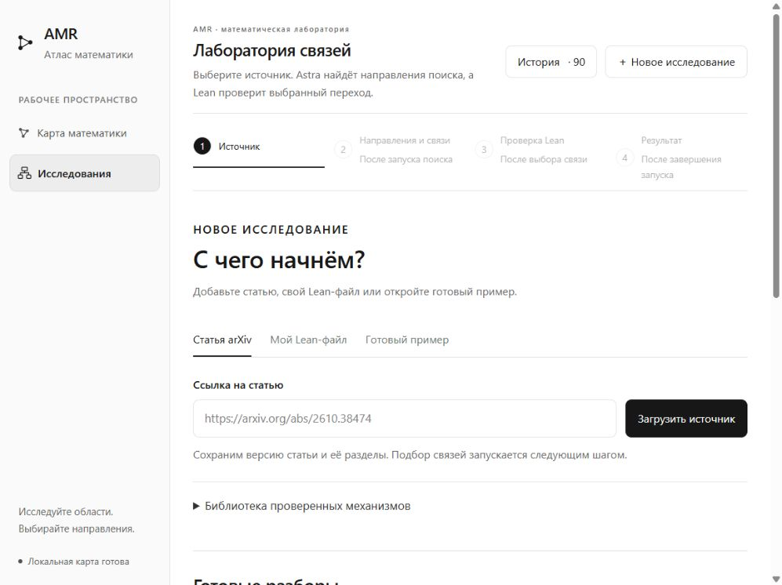
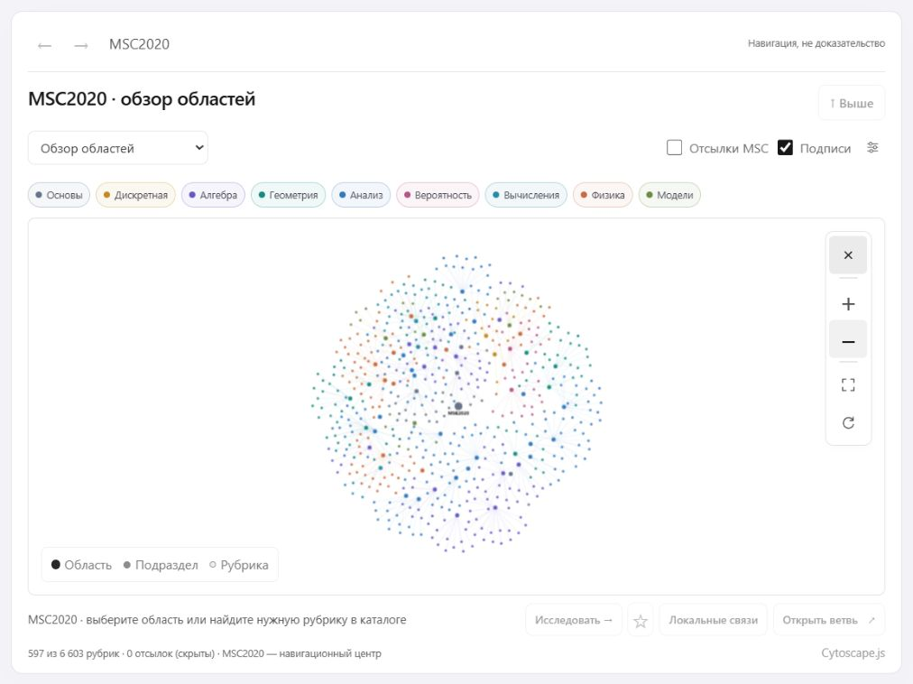
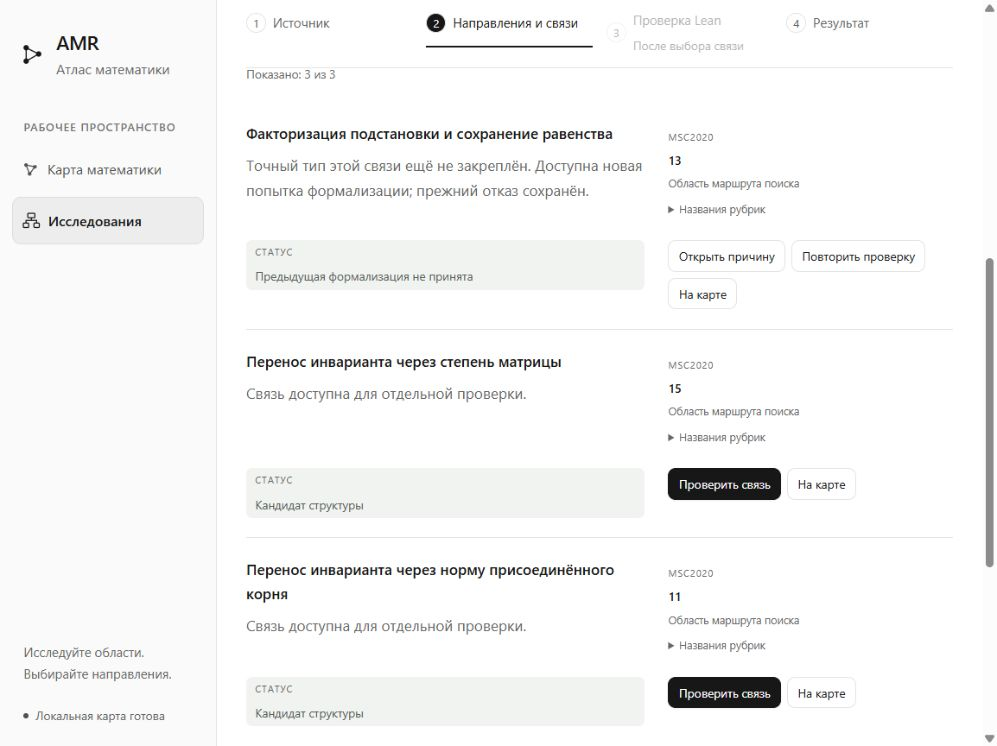
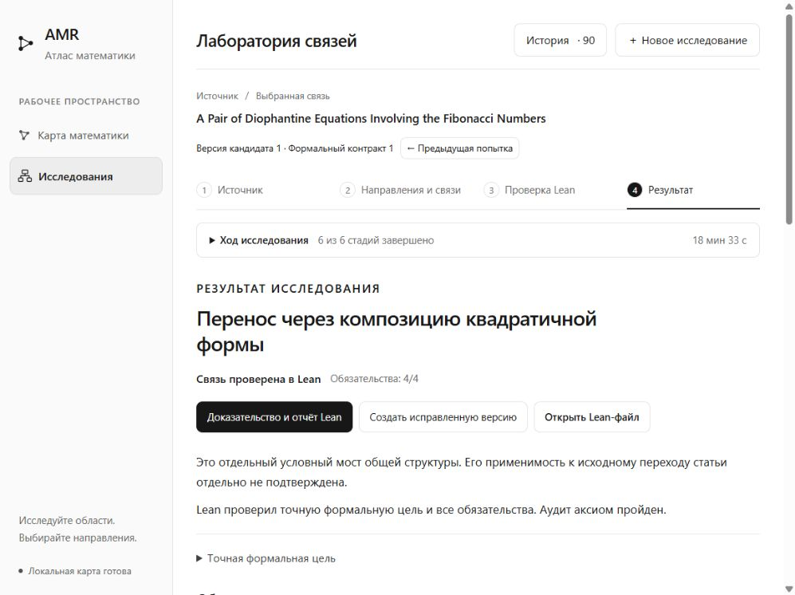
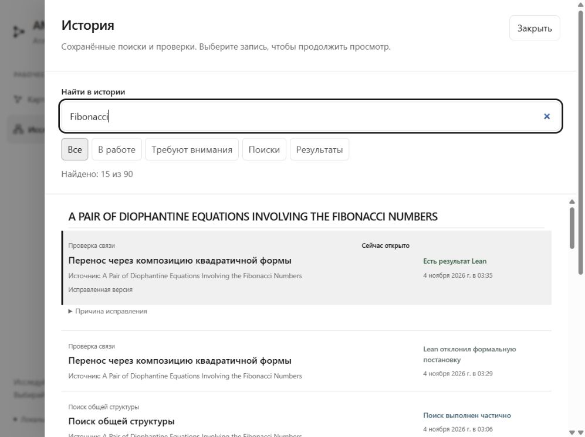
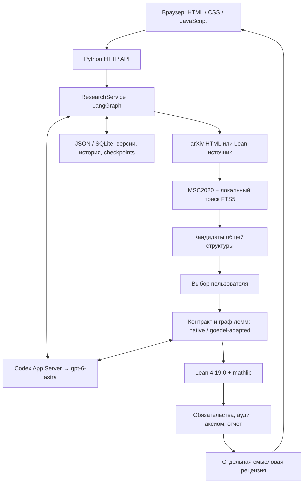

# AMR — Атлас математики

## Содержание

- [О проекте](#о-проекте)
- [Возможности](#возможности)
- [Быстрый запуск](#быстрый-запуск)
- [Как пользоваться](#как-пользоваться)
- [Готовые примеры](#готовые-примеры)
- [Интерфейс](#интерфейс)
- [Архитектура](#архитектура)
- [Настройки и данные](#настройки-и-данные)
- [Проверки и разработка](#проверки-и-разработка)
- [Если что-то не работает](#если-что-то-не-работает)
- [Документация](#документация)

## О проекте

**AMR помогает искать, где ещё можно применить математический приём из статьи.**
Вы даёте ссылку на статью arXiv и выбираете шаг её рассуждения — например,
замену переменных, разложение выражения или преобразование уравнения. Система
ищет в других областях математики задачи и конструкции, для которых может
подойти тот же приём, объясняет предложенные связи и помогает проверить
выбранную связь с помощью Lean — программы для проверки математических доказательств.

Сначала модель Astra разбирает выбранный фрагмент статьи: с какими объектами
работают авторы, какую операцию выполняют, какие условия используют и что
получают в результате. Затем система ищет похожую структуру по атласу из
6603 рубрик математической классификации MSC2020 и локальной библиотеке
Lean/mathlib. Атлас задаёт области поиска; для предложенной связи нужно
указать конкретные объекты, операции и условия, которые соответствуют друг другу.
Так появляются **кандидаты для проверки** — гипотезы о том, куда можно
перенести выбранный приём.

Вы выбираете кандидата, а система формулирует точное утверждение о связи,
записывает его предпосылки и пытается построить доказательство. Lean проверяет
это доказательство. На выходе вы получаете исходный шаг статьи, описание
предложенной связи, формальное утверждение, Lean-код и отчёт о проверке
либо причину, по которой попытка не удалась. Успешная проверка относится
именно к записанному утверждению при указанных условиях; применимость этих
условий к исходной статье рассматривается отдельно.

Например, в готовом разборе статьи об уравнениях с числами Фибоначчи проверена
связь алгебраического шага с композицией квадратичной формы. Lean подтвердил
четыре формальных обязательства при заданных предпосылках; выполнение этих
предпосылок для самой последовательности Фибоначчи ещё требует доказательства.
Чтобы увидеть, как выглядит такой результат, откройте
**«Исследования» → «Готовые разборы» → «Как получен результат»**, затем нажмите
**«Проверить 4 обязательства»**: приложение повторит проверку сохранённого
доказательства на вашем компьютере. [Инструкции запуска](#быстрый-запуск)
и [другие примеры](#готовые-примеры) приведены ниже.

## Возможности

- Просмотр **6603 рубрик MSC2020**: обзор областей, отдельные ветви и локальные связи.
- Импорт статьи arXiv с фиксацией версии, разделов и происхождения фрагментов.
- Выделение математических объектов, предпосылок и переходов между ними.
- Поиск кандидатов по всему атласу и локальному индексу Lean/mathlib.
- Отдельная проверка выбранного кандидата: формальная постановка, граф лемм,
  компиляция, аудит аксиом и смысловая рецензия.
- История, версии постановок, ограниченные бюджеты и сохранение частичных результатов.
- Готовые разборы с повторной локальной проверкой без нового вызова модели.

README описывает ветку **`codex/atlas-wide-search`**. Последний отдельный
[релиз v0.3.0](https://github.com/Medrov/astra-math-research/releases/tag/v0.3.0)
предшествует текущему интерфейсу; команды ниже выбирают актуальную ветку.
[Изменения ветки](apps/msc-lean-atlas/RELEASE_NOTES.md).

## Быстрый запуск

### Что установить

| Компонент | Для чего нужен |
| --- | --- |
| Git и Python 3.12 | Получить проект и запустить локальный сервер. |
| [elan / Lean / Lake](https://lean-lang.org/install/manual/) | Проверять Lean-источники. Репозиторий закрепляет Lean **4.19.0** и конкретную версию mathlib. |
| Codex CLI с авторизацией и доступом к **`gpt-6-astra`** | Запускать новое извлечение переходов, поиск и генерацию доказательств. |
| Node.js и npm | Только для разработки, тестов и пересборки frontend. Готовые браузерные ресурсы уже включены в Git. |

Карта и повтор подготовленных доказательств не вызывают модель. Интернет нужен
для установки зависимостей, нового импорта arXiv и модельных запросов.

### Windows · PowerShell

Из каталога, в котором хотите разместить проект:

```powershell
git clone https://github.com/Medrov/astra-math-research.git
cd astra-math-research
git switch --track origin/codex/atlas-wide-search
lake update
lake exe cache get

cd apps/msc-lean-atlas
python -m venv .venv
.\.venv\Scripts\python.exe -m pip install -r requirements-research.lock
.\.venv\Scripts\python.exe -X utf8 -c "import research_retrieval; print(research_retrieval.build_index())"
.\start.ps1 -Port 8765
```

Скрипт запуска включает UTF-8 и выбирает компилятор через `elan which lean`.
Если политика PowerShell блокирует локальный скрипт, можно запустить сервер
непосредственно из той же папки:

```powershell
$env:PYTHONUTF8 = '1'
$env:ATLAS_LEAN = (& elan which lean).Trim()
.\.venv\Scripts\python.exe -X utf8 server.py --port 8765
```

### Linux / macOS

```sh
git clone https://github.com/Medrov/astra-math-research.git
cd astra-math-research
git switch --track origin/codex/atlas-wide-search
lake update
lake exe cache get

cd apps/msc-lean-atlas
python3.12 -m venv .venv
.venv/bin/python -m pip install -r requirements-research.lock
export PYTHONUTF8=1
export ATLAS_LEAN="$(elan which lean)"
.venv/bin/python -c 'import research_retrieval; print(research_retrieval.build_index())'
sh ./start.sh --port 8765
```

### Открыть приложение

Перейдите в **[Исследования](http://127.0.0.1:8765/#research)** или
**[Карту математики](http://127.0.0.1:8765/#map)**. Остановка сервера — `Ctrl+C`.
При следующих запусках достаточно команды `start.ps1` или `start.sh`
из папки приложения; на Linux/macOS сохраните настройку `ATLAS_LEAN`.

**Индекс создаётся явно.** После `build_index()` ожидаются `status: ready`,
`Mathlib` в `sources` и ненулевые `files` / `declarations`. Сервер не строит его
автоматически. Повторите эту команду после изменения библиотечного корпуса.

Для нового исследования `codex` должен находиться в `PATH` либо быть указан
через `AMR_CODEX_BIN`. Адаптер использует существующую авторизацию Codex.
[Статус подключения](http://127.0.0.1:8765/api/research/status) проверяет доступность
без генерации. Подробности — в [настройке Codex](apps/msc-lean-atlas/CODEX_ADAPTER.md).

## Как пользоваться

### Посмотреть готовый результат

1. Откройте **«Исследования» → «Готовые разборы»**.
2. Раскройте **«Как получен результат»**: источник, математический механизм,
   проверенное утверждение и его границы.
3. Нажмите **«Проверить 4 обязательства»** или **«Проверить полиномиальный шаг»**.
   Приложение выполнит новый локальный повтор Lean без Astra.
4. Прочитайте новый результат проверки. Историческая отметка на карточке
   сама по себе не подтверждает успешную проверку на вашем компьютере.

### Исследовать статью

1. Выберите **«Статья arXiv»**, вставьте ссылку и нажмите **«Загрузить источник»**.
2. Выберите раздел и запустите **«Найти переходы в статье»**. Этот шаг вызывает Astra.
3. Изучите карту объектов и выберите конкретный переход: входы, условия и вывод.
4. Задайте бюджет и нажмите **«Искать по всему атласу»**.
5. Просмотрите кандидатов, их источники, рубрики и основания соответствия.
   Нажмите **«Проверить связь»** у выбранного кандидата.
6. На экране **«Результат»** прочитайте точную цель, обязательства, условия
   и отчёт Lean либо причину, по которой проверка не завершилась.

Импорт использует доступный **полный HTML arXiv**. PDF/OCR-парсинг сейчас не
подключён. Загрузка источника и модельный анализ запускаются разными действиями.

### Начать с Lean-теоремы

Выберите **«Мой Lean-файл» → «Проверить источник»**, затем нужную теорему
и **«Искать по всему атласу»**. Для обычной загрузки поддержаны импорты
Mathlib/Init/Std. В разделе **«Готовый пример»** также доступны подготовленные
входы проекта, включая связь энергии ассоциатора с графовым лапласианом.

### Читать статусы и продолжать работу

Верхние этапы **«Источник» → «Направления и связи» → «Проверка Lean» →
«Результат»** переключают просмотр текущего исследования. Навигация и история
не запускают генерацию заново.

| Результат | Что он означает |
| --- | --- |
| Найдены кандидаты | Есть предложенные связи; их применимость ещё предстоит проверить. |
| Постановка принята | Определения и типы целей прошли подготовку; доказательство ещё требуется. |
| Связь проверена в Lean | Проверены точные формальные обязательства и допустимые аксиомы. |
| Постановка отклонена / проверка не завершена | В этой попытке доказанного результата нет; причина сохранена. |
| Поиск выполнен частично | Сохранены выполненная часть очереди и доступные кандидаты. |

Продолжение поиска создаёт новую попытку с отдельным бюджетом. Изменение
формального утверждения создаёт новую версию. Предыдущие результаты остаются
в истории. Отказ формализации или исчерпание бюджета не доказывают невозможность
математической связи.

## Готовые примеры

| Статья и шаг | Проверенный результат | Граница |
| --- | --- | --- |
| **[A Pair of Diophantine Equations Involving the Fibonacci Numbers](https://arxiv.org/abs/2409.02933v1), §2** | Условный мост через композицию квадратичной формы на ℚ²: структура, подстановка, перенос и нормализация — **4 обязательства**. | Предпосылки для членов последовательности Фибоначчи отдельно не доказаны. [Код и повторение](apps/msc-lean-atlas/examples/fibonacci_composition/README.md). |
| **[On the motivic approach to the Abhyankar rectifiability problem and concrete rectifications](https://arxiv.org/abs/2610.38474v1), §9.1** | Вычитание полиномиального графа: две обратные замены координат и перевод графа в координатную ось. | Проверяется заключительный шаг раздела, а не вся статья. [Код и границы](apps/msc-lean-atlas/examples/arxiv_graph_subtraction/README.md). |

[Пошаговый разбор обоих примеров](apps/msc-lean-atlas/docs/SHOWCASES.md)
объясняет, как получены результаты и какие утверждения проверяет повтор.
Отдельно сохранены [мосты к координатной алгебре и её спектру](apps/msc-lean-atlas/examples/common_structure/README.md).

В документации есть и неуспешный проход по **A probabilistic proof of a binomial
identity**: источник и кандидат получены, но Lean отклонил формальную постановку.
[Отчёт этого запуска](apps/msc-lean-atlas/checks/peterson-pipeline.json)
фиксирует исход `unknown`, а не опровержение задачи.

## Интерфейс

Снимки сделаны **4 ноября 2026 года в текущем интерфейсе AMR** через Computer Use.
История, кандидаты и результат открыты из сохранённых исследований; ради снимков
новые модельные запуски и проверки Lean не выполнялись. В новом клоне история
пуста, а готовые разборы доступны сразу.

**Старт исследования:** статья arXiv, свой Lean-файл или готовый пример.



<details>
<summary>Карта математики — обзор MSC2020</summary>

В развёрнутом обзоре показаны области и подразделы. Полный классификатор
содержит 6603 рубрики; цвет обозначает тематическую группу.



</details>

<details>
<summary>Кандидаты — отдельный статус каждой связи</summary>

Список сохранённого поиска по статье о Фибоначчи: одна предыдущая формализация
отклонена, ещё два кандидата доступны для отдельной проверки.



</details>

<details>
<summary>Результат Lean — точная область доказанного</summary>

Сохранённый условный мост через квадратичную форму: 4/4 обязательства,
отчёт Lean и явно указанные ограничения применимости.



</details>

<details>
<summary>История — поиски, попытки и исправленные версии</summary>

Поиск по названию источника объединяет связанные исследования и позволяет
вернуться к успехам, отказам и частичным результатам.



</details>

## Архитектура

AMR — **локальное веб-приложение с Python-контроллером исследований**.
Браузер отвечает за взаимодействие, контроллер — за источники, бюджет и стадии,
Astra — за предложения и генерацию, Lean — за формальную проверку.



### Компоненты и их роли

| Компонент | Что используется сейчас |
| --- | --- |
| **Интерфейс** | Статические HTML/CSS/JavaScript. Cytoscape.js с fCoSE/Dagre рисует карты и графы; KaTeX отображает формулы. |
| **HTTP API** | Python `ThreadingHTTPServer` в [server.py](apps/msc-lean-atlas/server.py). По умолчанию слушает `127.0.0.1:8765`. |
| **Оркестрация** | [ResearchService](apps/msc-lean-atlas/research_service.py), LangGraph `StateGraph`, SQLite checkpoints. Сохраняются стадии, версии, лимиты и исход каждой попытки. |
| **Модель** | `gpt-6-astra` через локальный процесс **Codex App Server по stdio**. Адаптер использует авторизацию Codex и не подменяет модель автоматически. |
| **Поиск** | SQLite **FTS5/BM25**, точные имена, словарное расширение и текстовые сигнатуры Lean. Затем — модельная оценка применимости и разрешение выбранных библиотечных деклараций через Lean. |
| **Корпус и атлас** | Закреплённый MSC2020, локальные исходники Mathlib/MathResearch и подготовленные материалы. Обзор всех кодов предшествует ограниченной очереди углублённого поиска. |
| **Проверка** | Настоящий Lean **4.19.0**, закреплённая mathlib, точные типы всех обязательств, зависимости и аудит аксиом. |
| **Хранение** | Локальные JSON-артефакты и SQLite: источники, индекс, объекты, checkpoints и история исследований. |

### Движки доказательства

- **`native`** — собственный контроллер AMR, выбран по умолчанию.
- **`goedel-adapted`** — адаптация закреплённых функций ядра Goedel-Architect:
  проверка графа, привязка доказательства к сигнатуре и анализ зависимостей.
  План хранится в JSON, в Lean передаются полные доказательства.

Оба движка используют тот же Codex/Astra, бюджет и финальную проверку Lean.
В агентном режиме независимые готовые узлы могут проверяться по два параллельно.
Goedel подключён как производная интеграция, а не неизменённый upstream CLI;
наличие адаптера не означает доказанного превосходства над `native`.
[Происхождение, хеши и ограничения](apps/msc-lean-atlas/GOEDEL_ADAPTER.md).

### Что означает поиск по всему атласу

Первичный обзор учитывает все **6603 кода MSC** и документы без присвоенной рубрики.
Дальнейшая работа выбирает направления и кандидатов в пределах бюджета.
Обзор кодов, покрытие корпуса, найденные кандидаты и доказанные связи учитываются
отдельно. Это поиск по подготовленному локальному корпусу, а не обход всей
математической литературы в интернете. [Подробности](apps/msc-lean-atlas/ATLAS_SEARCH.md).

Компиляция Lean, соответствие исходной статье и научная новизна — разные
проверки. Принятое доказательство относится к сохранённому формальному контракту;
дополнительные предпосылки ещё требуется обосновать для объектов статьи.

## Настройки и данные

| Настройка | Назначение |
| --- | --- |
| `AMR_CODEX_BIN` | Путь к Codex CLI, если `codex` отсутствует в `PATH`. |
| `ATLAS_LEAN` | Путь к реальному компилятору закреплённого toolchain; `elan which lean` выдаёт нужный путь из проекта. |
| `ATLAS_MATHLIB` | Корень mathlib; обычно определяется как `.lake/packages/mathlib` в проекте. |
| `ATLAS_PROJECT_ROOT` | Корень проекта, если автоматическое определение не подходит. |
| `PYTHONUTF8=1` | UTF-8 для Python; включается скриптом Windows. |
| `-Port` / `--port` | Порт сервера в Windows-скрипте / Python и POSIX-скрипте. |

Лимит времени, число вызовов и движок выбираются перед модельным запуском.
Извлечение, поиск и проверка — отдельные действия. Показанный бюджет очереди
относится к её составу; лимит вызовов и времени не является денежным лимитом.
Незавершённая работа после перезапуска сервера не продолжается автоматически.

```text
apps/msc-lean-atlas/
├── web/                    интерфейс и готовые браузерные ресурсы
├── server.py               локальный HTTP API
├── research_*.py           источники, поиск, версии и контроллер доказательства
├── data/                   закреплённый классификатор MSC2020
├── research_fixtures/      подготовленные Lean-входы
├── examples/               переносимые доказательства и инструкции повторения
├── checks/                 отобранные датированные отчёты
├── tests/                  Python- и JavaScript-проверки
└── research_data/          локальная история, статьи и индексы — вне Git
```

`research_data/`, рабочие `runs/` и `verification/`, `.venv/` и `node_modules/`
остаются на компьютере пользователя. Новый клон получает код и подготовленные
примеры, но не локальную историю. [GitHub Pages](https://medrov.github.io/astra-math-research/)
содержит статические материалы; для исследований нужен локальный сервер.

## Проверки и разработка

Версии Python-зависимостей закреплены в
[requirements-research.lock](apps/msc-lean-atlas/requirements-research.lock),
JS-зависимостей — в [package-lock.json](apps/msc-lean-atlas/package-lock.json),
Lean и mathlib — в [lean-toolchain](lean-toolchain) и [lake-manifest.json](lake-manifest.json).

Из `apps/msc-lean-atlas`, после подготовки окружения:

```powershell
$env:PYTHONUTF8 = '1'
$env:ATLAS_LEAN = (& elan which lean).Trim()
npm.cmd ci --ignore-scripts
.\.venv\Scripts\python.exe -X utf8 -m unittest discover -s tests -v
node --test tests/*.cjs
```

На Linux/macOS используйте `.venv/bin/python` и `npm`, задав `ATLAS_LEAN`
как в быстром запуске. Тесты с Lean требуют подготовленной mathlib;
пропущенный тест не является успешной проверкой. Полный набор не запускает
платные модельные исследования.

Повтор пакета Фибоначчи без модели, **из корня репозитория**:

```sh
lake env python apps/msc-lean-atlas/examples/fibonacci_composition/verify.py
```

Если Python доступен под именем `python3.12` или `python3`, замените `python`
в этой команде на установленное имя.

Проверьте код завершения и новый отчёт в `apps/msc-lean-atlas/verification/`.
[Отчёт проверки публикации от 4 ноября 2026 года](apps/msc-lean-atlas/checks/publication-2026-11-04.json)
сохраняет фактические результаты своего запуска; он не заменяет новую проверку.

Для пересборки браузерных ресурсов доступны `npm run build:graph` и
`npm run build:math`. Исходный комплект `MathResearch.lean` / `MathResearch/`
проверяется отдельно по [REPRODUCE.md](REPRODUCE.md). Его исторические
**11 исходников / 149 деклараций** не являются размером тестового набора приложения.

## Если что-то не работает

| Ситуация | Действие |
| --- | --- |
| Карта открылась, модель недоступна | Проверьте Codex CLI, авторизацию, доступ к `gpt-6-astra`, `AMR_CODEX_BIN` и [статус](http://127.0.0.1:8765/api/research/status). |
| Библиотечная выдача пустая | Постройте индекс через `build_index()`; проверьте `Mathlib` в `sources`. Пустой результат поиска не опровергает математическую связь. |
| Не удалось загрузить статью | Проверьте arXiv-ссылку и наличие полного HTML выбранной версии. |
| Lean не собирает источник | Проверьте `ATLAS_LEAN`, закреплённую mathlib и результат `lake exe cache get`. |
| Ошибка создания `.olean` на Windows | Используйте короткий рабочий путь; для тестов можно задать `TEMP` и `TMP` на существующий короткий каталог. |
| Порт 8765 занят | Передайте другой порт, например `-Port 8777` или `--port 8777`. |

## Документация

- [Подробная справка приложения](apps/msc-lean-atlas/README.md).
- [Готовые разборы и неуспешный проход](apps/msc-lean-atlas/docs/SHOWCASES.md).
- [Поиск по атласу](apps/msc-lean-atlas/ATLAS_SEARCH.md) и [общая структура](apps/msc-lean-atlas/COMMON_STRUCTURE.md).
- [Метод и границы выводов](apps/msc-lean-atlas/RESEARCH_METHOD.md).
- [Графы, версии, сертификаты и API](apps/msc-lean-atlas/OBJECT_GRAPH.md).
- [Codex App Server](apps/msc-lean-atlas/CODEX_ADAPTER.md) и [Goedel-Architect](apps/msc-lean-atlas/GOEDEL_ADAPTER.md).
- [Состав публикации](apps/msc-lean-atlas/PUBLICATION.md) и [изменения](apps/msc-lean-atlas/RELEASE_NOTES.md).
- [Источники и лицензия MSC2020](apps/msc-lean-atlas/data/ATTRIBUTION.md); атрибуция сторонних компонентов сохранена рядом с их исходниками.
- [Три исходные математические задачи](WALKTHROUGH.md), [препринт](docs/Preprint.pdf) и [интерактивные материалы](docs/Interactive.html).
