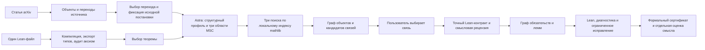

# «Найти общую структуру»

Основной вход — **выбранный переход статьи** с его объектами, предпосылками,
операцией и выводом. Astra предлагает структурный паттерн, выбирает три другие
верхние области MSC2020 и ищет аналогичные конструкции в установленной
Lean-библиотеке. Пользователь выбирает общую структуру; её точная формализация
и доказательство выполняются отдельным запуском. Вход от одной проверенной
Lean-теоремы также сохранён. Литературный вход не считается проверенной теоремой.



LangGraph управляет обоими процессами и сохраняет checkpoints в SQLite.
Существующий граф лемм, ограниченные роли и пересмотр плана по мотивам
Goedel-Architect сохранены. Это собственная реализация подхода, не установленный
движок Goedel-Architect. Вызовы Astra идут через существующий Codex App Server.

## Как пользоваться

1. Откройте «Исследования», выберите статью arXiv и загрузите источник.
   Найдите переходы статьи либо откройте сохранённую карту из истории.
2. Выберите номер перехода. Сверьте входы, выходы, утверждение и условия.
3. Нажмите **Найти аналоги в других областях**. Готовый Lean-файл для этого
   шага не нужен. Исходная постановка сохраняется с версией карты и хешем.
4. Дождитесь предложенного паттерна и трёх направлений MSC. Каждое направление
   показывает причину выбора и фактические библиотечные источники. Поисковый
   приоритет сравнивает кандидатов одного направления, а не вероятность истины.
5. На этапе **Направления и связи** сравните карточки **Кандидаты и проверки**.
   Можно проверить одну доступную связь либо нажать **Проверить все доступные
   связи**, просмотреть список и общий лимит, затем начать последовательную очередь.
   Уже проверенные постановки и кандидаты, требующие исправления, пропускаются
   с объяснением. Отказ одной связи сохраняется, а очередь переходит к следующей.
   Для отдельной связи на карте также доступно **Проверить общую структуру в Lean**.
   Создаётся отдельный запуск с точным контрактом и графом обязательств.
   По ходу работы видны фактические этапы и возможность остановки.
6. Прочитайте проверенную цель, предпосылки, смысловую рецензию и ограничения
   переноса на исходную статью. Вернуться можно как к кандидатам поиска, так
   и к исходному переходу. Журнал и исходники доступны в материалах исследования.

Если формализатор возвращает «нужно уточнить постановку», результат показывает
причину и кнопку **Уточнить постановку**. Редактор сохраняет новую версию
выбранного перехода и его собственных объектов; общий литературный контекст
доступен только для чтения. Остальные кандидаты и прежняя попытка сохраняются.
Сохранение версии не запускает доказательство и не переносит сертификат:
проверку новой формулировки нужно запустить отдельно. При сужении задачи
согласуйте утверждение, условия, преобразование и определения объектов.

### Если проверка остановилась

Верхние этапы **Источник → Направления и связи → Проверка Lean → Результат**
переключают разделы текущего исследования. «Источник» открывает закреплённую
версию статьи или теоремы, «Направления и связи» — сохранённую карту,
«Проверка Lean» — точную цель, диагностику и доступный граф лемм. Итог остаётся
на четвёртом этапе. Возврат не изменяет постановку и не создаёт новый запуск.
Ещё не доступные этапы подписаны; журнал работы открывается отдельной кнопкой.

Результат показывает этап остановки и причину. Отклонённый план, некорректный
формат ответа исполнителя, отсутствие текста доказательства, неуспешная
Lean-проверка и исчерпание бюджета — разные исходы. Ни один из них сам по себе
не означает, что математическая связь отсутствует.

Перед доказательством блок **«Постановка в Lean»** показывает отдельную
проверку определений и типов всех обязательств. Lean должен принять каждую
цель как пропозицию (`Prop`). Успех этой проверки означает, что формальная
постановка корректно типизирована, а не что утверждение доказано. При отказе
видны ошибки компилятора; агент не тратит бюджет на доказательство неверно
записанной цели. Результат и исходник `ContractTypes.lean` сохраняются отдельно
от доказательства и его сертификата.

Предварительная рецензия проверяет соответствие постановки исходному замыслу.
Итоговая рецензия сопоставляет уже полученное доказательство с этим замыслом.
Если до неё не дошли, интерфейс сообщает «не проводилась» с причиной.
Для простого поиска кандидатов итоговая рецензия доказательства не применяется.
Успешный отчёт Lean сохраняется отдельно, даже если дальнейший этап прерван.

**Повторить проверку** создаёт новую попытку той же зафиксированной постановки
с прежним режимом и лимитом. Исходная попытка, её ошибка и диагностика остаются
в истории. Повтор не означает изменения математического утверждения и не
гарантирует успешного доказательства. Техническая диагностика доступна отдельно
от понятного пользователю объяснения причины.

Карточки кандидатов различают следующие состояния:

| Состояние | Что означает и что делать |
| --- | --- |
| Доступна для проверки | Можно проверить отдельно или включить в общую очередь. |
| Нужна исправленная постановка | Lean отверг определения или типы. Сначала нужна новая версия; это не опровержение связи. |
| Нужно уточнить объём задачи | Формализатор не смог сохранить весь заявленный вывод в точном контракте. В результате указаны недостающие определения и условия. |
| Есть результат точной постановки | В архиве найдено совпадающее проверенное формальное утверждение. Откройте его область действия; сертификат на текущую карту автоматически не переносится. |

Общая очередь не исправляет и не сужает математическую постановку сама.
Остановка, отказ или завершение очереди — статусы работы; они не означают
доказательство или опровержение. Такой вывод требует отдельного отчёта Lean.

Альтернативный вход — **Мой Lean-файл** или подготовленная теорема точной версии
статьи. Исходник компилируется, пользователь выбирает декларацию и запускает
поиск по трём MSC. Для Фролова–Дорофеева сохранена отправная точка
`subtract_restore` («Обратимость: F после G»). Подготовленный шаг не является
автоматической формализацией всей статьи; UI указывает его точный охват.

Для статьи без Lean-входа основной путь:
**Найти переходы в статье → выбрать переход → Найти аналоги в других областях
→ выбрать кандидата → Проверить общую структуру в Lean**.
Перед запуском зафиксированы полный claim, условия, входные и выходные объекты,
источники, версия карты и хеш снимка. Отдельного доказательства исходной статьи
для поиска не требуется. Профиль явно предложен моделью, а найденный bridge
ещё не доказан. Если формализация описывает общий механизм при дополнительных
условиях, применение этих условий к статье остаётся отдельным обязательством.
Прямая проверка исходного утверждения — дополнительное действие, не цель поиска.

Основной экран использует режим `multi`: существующее агентное исследование
с планированием, критикой и доказательством. В расширенных инструментах доступны
последовательный исследователь (`single`) и повтор готового доказательства
без модели (`pilot`). Поиск структуры использует тот же последовательный
профиль и три маршрута; роли планировщика/критика относятся к процессу доказательства.

В основном сценарии лимит каждого этапа — **16 вызовов / 30 минут**; его можно
изменить в «Пожелания и лимит работы». Поиск и доказательство имеют отдельные
бюджеты. Серверные значения по умолчанию без явного бюджета — 8 вызовов /
600 секунд. Остановка сохраняет выполненные шаги. Процент готовности заранее
неизвестен. Исчерпание бюджета не означает отсутствия математической связи.

Формулы отображаются локальным KaTeX без CDN. Обычный текст и Lean-код не
исполняются как HTML; ошибочный LaTeX остаётся читаемым исходным текстом.
Краткие математические описания готовых примеров применяются только при
совпадении исходника, его типа и точного контракта. Формальный статус определяется
отдельно фактическим отчётом Lean и смысловой рецензией.

## Что именно ищется

Три маршрута выбираются по структуре исходной теоремы или перехода статьи;
они не зашиты под один пример. Для литературного входа исключаются исходные
верхние области его объектов (при отсутствии меток — области исходной карты).
На маршрут допускаются 1–3 запроса, до пяти результатов ранжирования
и до двух связей. Индекс использует FTS5/BM25, объединение рангов и небольшой
бонус за совпадение структурных слов. Это прозрачная поисковая эвристика,
а не алгоритм определения математической эквивалентности или вероятности истины.

Корпус — явно построенный локальный индекс заголовков деклараций mathlib/Lean.
Полные доказательства корпуса и все статьи arXiv он не сканирует. Извлечённые
текстовые сигнатуры могут не включать окружающие binders и сгенерированные
`to_additive` декларации. Их корректность устанавливается при реальной Lean-проверке.
Источник, запросы, результаты, версия индекса и бюджет сохраняются в запуске.
Детерминированный seed Codex App Server не предоставляет; seed не выдумывается.

Отсутствие кандидатов — допустимый результат. Неудача одной ветви не скрывает
остальные. Модель не может выдать придуманную ссылку за результат поиска:
контроллер принимает только идентификаторы фактически переданных источников.

## Привязка к исходной математике

Загруженный текст хранится неизменным вместе с SHA-256, выбранной декларацией,
экспортированным типом и fingerprint Lean/mathlib. При доказательстве он заново
компилируется как `StructureInput`, сохраняя исходные namespaces. Мост обязан
импортировать этот модуль и содержать pin хеша. Изменение исходника, выбранного
типа или окружения требует нового импорта/проверки.

Финальная проверка дополнительно требует участия выбранной исходной теоремы
или её исходных определений в типе/доказательстве моста. Общие константы mathlib
сами по себе не считаются связью. В отчёте раздельно видны участие в типе,
участие только в доказательстве и использование самой исходной теоремы.
Это структурный сигнал; смысловая рецензия всё равно необходима.

Поддержан один исходник с импортами Mathlib/Init/Std в установленном окружении.
Проекты из нескольких файлов и произвольные зависимости пока не импортируются.
Консервативный фильтр исходника и аудит запрещённых конструкций **не являются
песочницей для враждебного Lean-кода**: это локальная исследовательская программа.
`sorry`, `admit`, новые аксиомы, `native_decide` и `unsafe` не допускаются.
Команды `#print axioms` для авторских теорем выполняет проверяющий модуль.

## Пример Фролова–Дорофеева

Статья: A. S. Frolov, I. S. Dorofeev,
**On the motivic approach to the Abhyankar rectifiability problem and concrete rectifications**,
[arXiv:2610.38474v1, §9.1](https://arxiv.org/html/2610.38474v1#S9.SS1).

Подготовленный вход доказывает над произвольным коммутативным кольцом:

```text
S(x,y,z) = (y, x-b(y), z-w(y))
S⁻¹(T,X,Z) = (X+b(T), T, Z+w(T))
S ∘ S⁻¹ = id, S⁻¹ ∘ S = id
S(b(t),t,w(t)) = (t,0,0)
```

Это полиномиальные тождества заключительного шага, без построения
предшествующего автоморфизма и без формализации всей статьи.

Для контроля есть отдельно подготовленный и реально проверенный
[мост к `Equiv.prodShear`](examples/common_structure/README.md). Он описывает
сдвиг слоёв `(a,u) ↦ (a,u-f(a))` и связывает его с evaluation исходного
полиномиального преобразования. Контроль не передаётся Astra как якобы
найденный результат. Исходное доказательство доступно модели; эксперимент
проверяет повторное использование и перенос структуры, а не слепое переоткрытие.

В фактическом запуске 31 октября Astra выбрала MSC **13 / 14 / 37** и предложила
пять кандидатов. Выбранная связь с автоморфизмом координатной алгебры прошла
четыре Lean-обязательства, исправление двух неудачных попыток, финальную
пересборку и смысловую рецензию. Этот мост использует обе исходные теоремы
обратимости. Код, точный контракт и команда повторения без модели находятся
в [отчёте примера](examples/common_structure/README.md).

Следующим отдельным запуском проверен кандидат **MSC 14 о гомеоморфизме
спектра**: обе обратные подстановки, точный перенос идеала оси в идеал графа
и гомеоморфизм `Spec R[X₀,X₁,X₂]` с `h(V(graph))=V(axis)`.
Все три обязательства и финальная сборка прошли Lean над произвольным
коммутативным кольцом; смысловая рецензия — `aligned`.
Сохранённый код Astra воспроизводится командой
`python tools/reproduce_common_structure.py --spectrum` без вызовов модели.
Это топологический спектр с топологией Зарисского; структурный пучок схемы
и вся статья этим результатом не формализованы.

## API и данные

| Запрос | Результат |
|---|---|
| `GET /api/structure/sources` | Сохранённые источники и подготовленный вход |
| `POST /api/structure/sources` с `name, content` или `example_id` | Свежая компиляция и экспорт одного исходника |
| `GET /api/structure/sources/:id` | Неизменный снимок, типы и диагностика |
| `POST /api/research/runs` с `purpose:"structure", source_id, target, mode, budget` | Профиль, три маршрута, граф кандидатов |
| `POST /api/research/runs` с `purpose:"structure", graph_id, graph_revision, transition_id, mode, budget` | Поиск аналогов от фиксированного перехода статьи без фиктивного Lean-входа |
| Обычный `POST /api/research/runs` с `graph_id, graph_revision, transition_id` | Формализация и доказательство выбранной связи |

Снимки лежат локально в `research_data/structure_sources/`, исследования —
в `research_data/<run_id>/`. `structure-profile.json`, `structure/route_*/search.json`,
`candidates.json` и контракт фиксируют вход и каждый этап поиска.
В основном каталоге остаются два прежних примера. Исторический комплект
`MathResearch` с его 11 модулями и 149 декларациями не меняется.
